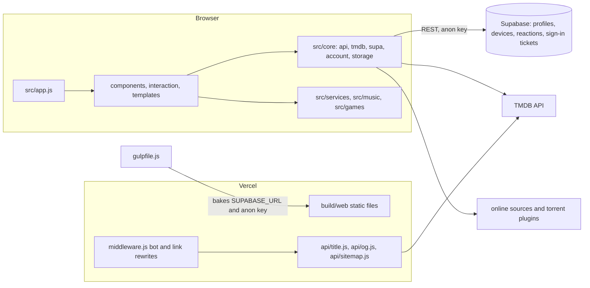

# HOOK TV: engineering audit

Read-only review of the repository on **2026-10-30**, branch `main` (`efdc6069`).
Companion documents: [Implementation plan](IMPLEMENTATION_PLAN.md), [Development and environments](DEVELOPMENT.md), [Git workflow](GIT_WORKFLOW.md).

## A. Executive summary

**Overall engineering health: 5 / 10.** The product has real strengths (a tested domain layer, careful link-preview and SQL code, a release model that is built from commit history). It is held back by one live blocker in the working tree (an unresolved merge), by a deploy pipeline that ships `main` without running any checks, and by the absence of a staging environment or lint gate.

**Rating limits.** Verified by reading code, running `vitest`, and running `node --check` on every tracked JS file. Not verified: a browser run of the app, a live Supabase database, the RLS tests (they need a Postgres/Supabase instance), a production build (`npm run release`), Lighthouse or Core Web Vitals, and manual or automated accessibility testing. Those areas are rated only on the code that can be read.

**Main strengths**
- 190 tests across 34 spec files pass on the current tree (`npx vitest run`).
- A localisation spec enforces the "every game has a title and hint in every pack" rule from [CLAUDE.md](../CLAUDE.md).
- The link-preview path ([api/title.js](../api/title.js)) escapes HTML and JSON-in-script (`esc()`, `<` replacement).
- Supabase secrets are kept out of git (`.env.local` is ignored; the anon key is injected at build time; the service-role key is explicitly kept out).
- The "What's new" list is generated from commit subjects ([scripts/releases.js](../scripts/releases.js)), so commit messages are part of the product.
- Database schema is versioned in `supabase/migrations/`, with row-level-security policies and a default-deny comment.

**Most important risks**
1. **P0.** A merge is in progress (`.git/MERGE_HEAD` = `feature/game-localisation`) and 8 files contain conflict markers. Four of them no longer parse.
2. **P1.** The production deploy workflow runs no tests and no build check before it deploys `main`.
3. **P1.** There is no staging environment. Every push to `main` is a production release.
4. **P1.** `package-lock.json` is git-ignored and not committed, so installs are not reproducible.
5. **P1.** The RLS test file is never executed by anything in the repo.

**Main architectural concerns.** Very large modules (`src/services/online.js` at 3,380 lines, `src/interaction/player/panel.js` at 1,530). Several files that are shared by many features are where the conflicts land. The duplicated Supabase schema (migrations plus a hand-made `supabase-setup.sql`) can drift.

**Main UX concerns.** Only partially assessed (code-level). Settings and navigation are documented as minimal, and the design page exists. Manual review is still needed for focus order on TV remotes and for the mobile layouts.

**Production readiness: not ready to ship from the current tree.** The blocker is the merge. Once it is resolved and the CI gate exists, the codebase is in a reasonable state for a release.

**Top five actions**
1. Resolve the in-progress merge of `feature/game-localisation` (owner decision; see [plan, Phase 0](IMPLEMENTATION_PLAN.md#phase-0-unblock-the-tree)).
2. Add a CI workflow that runs tests and a build, and make the deploy job depend on it.
3. Commit `package-lock.json` and use `npm ci` everywhere.
4. Create a staging path: Vercel preview deployments plus a separate Supabase project.
5. Run the RLS tests in CI against a local Supabase instance.

## B. Architecture map

- **Build**: `gulpfile.js` (gulp 4) merges `src/` and `plugins/` into `build/web`, compiles SASS, injects the Supabase config, and minifies in release mode.
- **Runtime**: a single bundle built from `src/app.js`. Modules communicate through `src/core` and the component layer.
- **Server**: three Vercel functions in `api/` and one edge middleware. There is no other server code.
- **Data**: Supabase tables defined in `supabase/migrations/0001`–`0004`. Access is through RLS policies and RPCs (`set_reaction`, `reaction_counts`).

**Auth flow.** The browser uses the Supabase anon key. Account rows are readable only through RLS. The TV sign-in uses a ticket: the TV creates a ticket and keeps `secret` locally, the phone approves it, and the TV claims it with the secret.

**Bottlenecks and coupling.** Shared modules have wide fan-in, which is why a change in `src/components/main.js`, `src/core/component.js` or `src/core/api/sources/tmdb.js` collides with other feature branches.

## C. Findings register

Severity follows the impact scale (P0 to P4). Confidence is High (verified in code or by a command), Medium (strong evidence, needs a runtime check) or Low.

| ID | Sev | Conf | Category | Title |
|---|---|---|---|---|
| F-01 | P0 | High | Delivery | Unresolved merge in the working tree; 4 JS files do not parse |
| F-02 | P1 | High | Delivery | Production deploy runs no tests or build gate |
| F-03 | P1 | High | Delivery | No staging environment; every `main` push is production |
| F-04 | P1 | High | Reproducibility | `package-lock.json` is ignored and not committed |
| F-05 | P1 | High | Security / DB | RLS tests in `supabase/tests/rls.sql` are never run |
| F-06 | P2 | High | Maintainability | Duplicated Supabase schema (`supabase-setup.sql` and migrations) |
| F-07 | P2 | High | Hygiene | Generated bundle committed under `build/github/` |
| F-08 | P2 | High | Hygiene | Local worktree (709 MB) holds uncommitted work |
| F-09 | P2 | High | Tooling | No lint, format or type-check configuration |
| F-10 | P2 | High | Security | No security headers (CSP, frame, referrer) in `vercel.json` |
| F-11 | P2 | High | Maintainability | Very large modules (`services/online.js` 3,380 lines) |
| F-12 | P2 | High | Observability | 224 `console.log` calls in `src/` and `api/` |
| F-13 | P2 | Medium | Tooling | Local Node 26 vs CI Node 22; vitest 0.32 (latest 5.x) |
| F-14 | P3 | High | Hygiene | `.freebuff/project-id` is committed |
| F-15 | P3 | High | Docs | Stale root docs (`FIXES.md`, `REFACTORING_SUMMARY.md`) and "StreamFlow" leftovers |
| F-16 | P3 | High | Config | Public TMDB key duplicated in `api/title.js` and the web client |
| F-17 | P3 | High | Config | Three git remotes (`origin`, `hooktv`, `lampro`); deploy source is not documented |
| F-18 | P3 | High | Hygiene | `.claude/worktrees/` and `.superpowers/` are ignored only in `.git/info/exclude` |
| F-19 | P4 | High | Naming | `src/core/tmdb/keys.js` is a content-filter keyword list, not keys |
| F-20 | P4 | High | Consistency | Comments in Russian (gulpfile), docs in English, UI in Ukrainian |

### F-01: Unresolved merge in the working tree (P0)
- **Evidence.** `git status` shows `UU` on `src/components/main.js`, `src/core/component.js`, `src/core/api/sources/tmdb.js`, `src/interaction/card/module/style.js`, `src/interaction/screensaver/ukraine.js`, `src/sass/components/card.scss`, `src/sass/components/screensaver.scss`, and `DU` on `src/interaction/screensaver/weather.js`. `.git/MERGE_HEAD` exists. `node --check` fails on `src/components/main.js`, `src/core/api/sources/tmdb.js`, `src/core/component.js` and `src/interaction/card/module/style.js`.
- **Why the tests did not catch it.** No spec imports these modules, so `vitest` stays green.
- **Impact.** Any build from this tree (or a commit of it) breaks the app's entry module.
- **Fix.** Owner of `feature/game-localisation` resolves the conflicts, runs `npm test` and a build, then commits the merge. Nothing was changed in this audit.

### F-02: Deploy without a gate (P1)
- **Evidence.** [.github/workflows/vercel-deploy.yml](../.github/workflows/vercel-deploy.yml) validates three secrets, then runs `vercel build --prod` and `vercel deploy --prod`. No `npm test`, no `npm ci`, no lint.
- **Impact.** A broken commit on `main` is deployed to production within minutes.
- **Fix.** Add `ci.yml` (test and build on pull requests and pushes) and set `needs: test` on the deploy job. See [plan, Phase 1](IMPLEMENTATION_PLAN.md#phase-1-add-the-quality-gate).

### F-03: No staging (P1)
- **Evidence.** `vercel.json` has no environment settings. The only deploy path is `--prod` on `main`. No `.env.staging` or second Supabase project is referenced.
- **Impact.** Schema changes and risky UI changes are tested only in production.
- **Fix.** Vercel preview deployments for every branch with a staging Supabase project. See [DEVELOPMENT.md](DEVELOPMENT.md#stage).

### F-04: Lockfile not committed (P1)
- **Evidence.** `.gitignore` contains `package-lock.json`; `git ls-files package-lock.json` returns nothing.
- **Impact.** Ranges such as `rollup ~2.58.0` and `sass ^1.43.4` resolve differently over time. Vercel and a developer's machine can build different bundles.
- **Fix.** Remove the ignore line, commit the lockfile, use `npm ci` in CI and on Vercel.

### F-05: RLS tests are never run (P1)
- **Evidence.** `supabase/tests/rls.sql` exists. The only references are in a plan document (`docs/superpowers/plans/2026-10-25-supabase-accounts.md`). Nothing in `package.json`, `gulpfile.js` or `.github/` runs it.
- **Impact.** The main authorization boundary for user data (profiles, devices, reactions) is verified only by reading. A policy regression would pass every check.
- **Fix.** A CI job that starts `supabase start` and runs the file with `psql`. See [plan, Phase 3](IMPLEMENTATION_PLAN.md#phase-3-database-as-code).

### F-06: Duplicated schema (P2)
- **Evidence.** `supabase-setup.sql` repeats the migrations. Both contain 6 tables and 5 policies today. The file is not referenced anywhere in the repo.
- **Impact.** A database set up with `supabase-setup.sql` can diverge from the migrations silently.
- **Fix.** Delete `supabase-setup.sql` once the team confirms nobody uses it, and document `supabase db reset` as the only path.

### F-07: Generated bundle committed (P2)
- **Evidence.** `build/` is ignored, but `!build/github/` re-includes it. `git ls-files build/github` returns 155 files, including `app.min.js`. `gulpfile.js` regenerates them (`sync_github`, `index_github`).
- **Impact.** Every release changes 155 tracked files and creates merge conflicts for no reason.
- **Fix.** Generate `build/github` in the release step instead of committing it, or document it as a release artifact.

### F-08: Worktree with uncommitted work (P2)
- **Evidence.** `git worktree list` shows `.claude/worktrees/music-redesign` on `feature/music-redesign`. Its `git status` lists modified files (`public/css/app.css`, `src/music/catalog.js`, and more). The directory is 709 MB.
- **Impact.** Removing the directory deletes that work. It is not in any remote branch.
- **Fix.** Commit or push that branch first. Then `git worktree remove` it. Do not delete it blindly.

### F-09: No lint, format or type check (P2)
- **Evidence.** `ls -a` shows no `.eslintrc*`, `eslint.config.*`, `.prettierrc*`, `.editorconfig`, `tsconfig.json`. `package.json` has only `test`, `start`, `release`, `debug`, `doc`.
- **Impact.** Style differs between files (mixed comment languages, 2-space and 4-space indentation). Unused variables and undefined names are caught only by the browser.
- **Fix.** Add ESLint (flat config) with `no-undef` and `no-unused-vars` for `src/`, `api/`, `middleware.js`. Add `.editorconfig`. Type checking can come later with `checkJs` on selected modules.

### F-10: No security headers (P2)
- **Evidence.** `vercel.json` has rewrites and one CORS header for `/msx/*`. No `Content-Security-Policy`, `X-Frame-Options` or `Referrer-Policy`.
- **Impact.** The app renders third-party content (TMDB images, provider streams). Without a CSP, an injected script has no restriction. The app can also be framed.
- **Fix.** Add headers in `vercel.json`. Start with `Referrer-Policy: strict-origin-when-cross-origin`, `X-Content-Type-Options: nosniff`, `frame-ancestors 'none'` (or `X-Frame-Options: DENY`). Add a CSP in report-only mode first and check the console on each route.

### F-11: Very large modules (P2)
- **Evidence.** `src/services/online.js` 3,380 lines; `src/interaction/player/panel.js` 1,530; `src/core/api/sources/tmdb.js` 1,498; `src/sass/_hooktv.scss` 4,303.
- **Impact.** Most merge conflicts in this branch are in shared files. Reviewing a change needs the whole file in context.
- **Fix.** Split by responsibility only where a change already touches a seam (for example one provider per file in `online.js`). Do not split for its own sake.

### F-12: Logging volume (P2)
- **Evidence.** `git grep -c "console\.log"` over `src/` and `api/` reports 224 occurrences.
- **Impact.** Noise in production consoles; possible leakage of request data if a log prints a response.
- **Fix.** One small logger with levels, off in release builds. Review the calls that print response bodies.

### F-13: Toolchain versions (P2, Medium)
- **Evidence.** CI uses Node 22 ([vercel-deploy.yml](../.github/workflows/vercel-deploy.yml)). The local machine uses Node 26.11. `vitest` is pinned to `^0.32.4`; `npm view vitest version` returns 5.0.5.
- **Impact.** Tests may pass locally and behave differently in CI. Old test tooling blocks security updates.
- **Fix.** Add an `.nvmrc` (`22`) and `engines`. Upgrade vitest in its own change, one major version at a time.

### F-14: Committed tool file (P3)
- **Evidence.** `git ls-files .freebuff` returns `.freebuff/project-id`. `.freebuff` is not in `.gitignore`.
- **Fix.** Ignore the directory and untrack it (`git rm --cached -r .freebuff`).

### F-15: Stale docs (P3)
- **Evidence.** `FIXES.md` documents a white-screen fix from before the current `manifest.js` design. `REFACTORING_SUMMARY.md` is titled "StreamFlow Refactoring Summary". [README.md](../README.md) says the API and CDN settings "still point at the StreamFlow services".
- **Fix.** Remove the two history files (git keeps them). Replace the README sentence with the real config location.

### F-16: Public TMDB key in two places (P3)
- **Evidence.** The same public key is hardcoded in `api/title.js`, `api/og.js`, `api/sitemap.js`, `src/core/tmdb/tmdb.js`, and in several `plugins/*` files (`git grep` on the key). The API files read `TMDB_API_KEY` from the environment first.
- **Impact.** Low: the key ships to every browser anyway. Rotating it means editing about seven places.
- **Fix.** Keep one default in `src/core/tmdb/tmdb.js` (or a shared constant for `api/`), and read `TMDB_API_KEY` from the environment everywhere else.

### F-17: Three remotes (P3)
- **Evidence.** `git remote -v` lists `origin`, `hooktv` and `lampro`, all on GitHub. Only `origin` is used by the deploy workflow's `main` branch.
- **Fix.** Keep `origin` for the work and remove the others, or document their purpose. See [GIT_WORKFLOW.md](GIT_WORKFLOW.md#remotes).

### F-18: Ignore rules only local (P3)
- **Evidence.** `.claude/worktrees/` and `.superpowers/` are listed in `.git/info/exclude`, which is not shared. `.gitignore` does not list them.
- **Fix.** Add them to `.gitignore`.

### F-19 and F-20: Naming and language (P4)
- `src/core/tmdb/keys.js` is a list of filtered keywords. Rename it to `content_filter_keywords.js` when the file is next touched.
- Gulpfile comments are in Russian; the rest of the code comments are in English. Pick English for code comments and keep the UI in its language packs.

## D. File-by-file review

| File | Why it needs attention |
|---|---|
| `src/components/main.js` | Conflict markers (F-01). Shared entry point. |
| `src/core/component.js` | Conflict markers (F-01). Base of every component. |
| `src/core/api/sources/tmdb.js` | Conflict markers (F-01). 1,498 lines, shared by Movies, Series, Search. |
| `src/interaction/card/module/style.js` | Conflict markers (F-01). |
| `src/services/online.js` | 3,380 lines (F-11). Split at provider boundaries when a provider changes. |
| `gulpfile.js` | Build, release and dev server in one file. `supabaseEnv()` reads `.env.local` for the bundle; comments in Russian (F-20). |
| `api/title.js` | Good escaping. Duplicates the TMDB key (F-16). |
| `middleware.js` | Bot detection and the `card` redirect. Covered by `spec/link_preview.spec.js`. Its `BOTS` pattern is a plain string list and should be reviewed each quarter. |
| `vercel.json` | No security headers (F-10). No environment mapping (F-03). |
| `.github/workflows/vercel-deploy.yml` | No test gate (F-02). `concurrency` and `fetch-depth: 0` are correct. |
| `supabase-setup.sql` | Duplicate of migrations (F-06). |
| `supabase/tests/rls.sql` | Never run (F-05). |
| `package.json` | No lint, format or engines (F-09, F-13). |
| `.gitignore` | Lockfile ignored (F-04); `.freebuff` and worktrees missing (F-14, F-18). |

## E. Security assessment

**Verified good**
- Supabase `.env.local` is ignored by git (`.gitignore`, `git check-ignore` confirms).
- The build injects only the anon key and URL. The gulpfile comment says the service-role key must never go there.
- A grep for common secret patterns (service-role JWT prefixes, `sk_live`, `ghp_`, `AKIA`, `VERCEL_TOKEN=`) over tracked files found nothing.
- `api/title.js` escapes text and encodes JSON for `<script>` (`<`).
- The database tables are created with `on delete cascade` to `auth.users`, and the schema comments state the default-deny rule.

**Verified gaps**
- F-05: the RLS test is not run, so the authorization boundary is unverified in CI.
- F-10: no CSP, no frame restrictions.
- F-16: the public TMDB key is in source. It is public by design, so this is a configuration issue and not a secret leak.

**Needs additional testing (not done in this audit)**
- Live RLS behaviour with two real users (needs a Supabase instance).
- The `api/` endpoints under malformed input (`card`, `media`, `source` query strings) and their rate limits (none seen in code).
- The torrent and online-source plugins: they fetch third-party URLs and render their content. Review the URL handling and the iframe or player sandboxing before expanding them.

## F. UI/UX assessment

Code-level review only. A browser run was not done in this audit.

- **Design system.** [DESIGN_SYSTEM.md](../DESIGN_SYSTEM.md), [BRANDING_GUIDE.md](../BRANDING_GUIDE.md), and `src/sass/theme/tokens.scss` define tokens. `public/design.html` is the design page; `spec/design_page.spec.js` checks it. This is a good base.
- **Accessibility declared.** `public/index.html` sets `lang="uk"`. `spec/brand.spec.js` and the design spec cover tokens. Focus rings and reduced motion need a manual check on TV remote navigation.
- **Information architecture.** The README describes a minimal top bar (Home, Movies, Series, Favorites, search, settings). The settings menu was intentionally reduced. This is consistent.
- **Risk.** The app is heavily themed by module (`src/interaction/*`). Some visual rules are duplicated per module; a token change may not reach them. Check with a screenshot pass after the merge.
- **Manual check needed.** Focus order on a TV remote; touch targets (44 px) on the mobile layout; contrast of the secondary text in the dark theme; behaviour when a title has no online source (the torrent fallback was added on 2026-10-29).

## G. Testing and reliability gaps

- **Good coverage of pure logic.** Tastes rules, dub detection, episode parsing, slug, torrent fallback, TMDB metadata, localisation completeness.
- **Missing.** No component or browser tests. No test runs `api/*` against recorded responses. No RLS test in CI (F-05). No accessibility test (axe) on the built pages.
- **Fragile.** `spec/games_localisation.spec.js` takes about 1.1 s and reads every language pack; fine today, but it grows with each pack.
- **Gate.** None (F-02).

**Recommended, by risk**
1. Gate: `npm test` and `npm run release` in CI.
2. RLS suite against a local Supabase.
3. Smoke test of the built `build/web` with Playwright (one page per route in `vercel.json`).
4. axe scan of `/`, `/design` and one movie page.

## H. Technical debt register

**Urgent**
- F-01 (merge), F-02 (gate), F-04 (lockfile), F-05 (RLS tests).

**Scheduled**
- F-03 staging, F-06 duplicated schema, F-07 committed bundle, F-08 worktree, F-09 lint, F-10 headers, F-12 logging.

**Optional**
- F-11 module splitting (only at seams), F-13 vitest upgrade, F-15 stale docs, F-17 remotes, F-19 and F-20 naming and language.

## I. Prioritized remediation roadmap

See [IMPLEMENTATION_PLAN.md](IMPLEMENTATION_PLAN.md) for phases, owners, effort, dependencies and definitions of done.

1. **Immediate blockers**: F-01.
2. **High priority**: F-02, F-04, F-05, F-03.
3. **Medium priority**: F-06, F-07, F-08, F-09, F-10, F-12, F-13.
4. **Long term**: F-11, F-16 consolidation, observability, a component test layer.

## J. Engineering standards

Recommended for this repository, based on the stack that exists today (gulp, vanilla ES modules, SASS, Vercel functions, Supabase):

1. **Branch protection on `main`.** Required status check: the CI test job. No force pushes.
2. **Commit subject format `Area: plain sentence`.** Used by [scripts/releases.js](../scripts/releases.js). See [GIT_WORKFLOW.md](GIT_WORKFLOW.md#commit-messages).
3. **Every change passes** `npm test`, `npm run release` and the localisation rules in CLAUDE.md before it is pushed to `main`.
4. **Lockfile committed**, installs with `npm ci`.
5. **Schema changes only as new migration files**, each with an RLS test case.
6. **No new `console.log` in `src/`**; use the logger once it exists.
7. **Generated output is not committed**, unless it is a release artifact with a stated reason.
8. **Secrets** only in `.env.local` (dev) and Vercel project environment variables (preview and production). Never in source.
