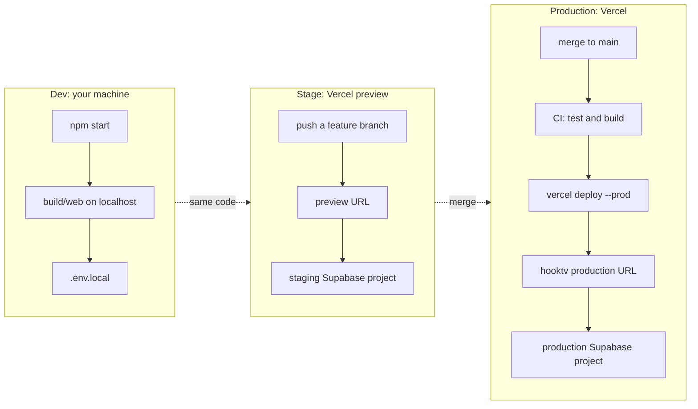

# Development, staging and production

Everything here is done from a terminal. No dashboard is needed except for the one-time setup steps marked **(one time)**.

## Prerequisites

| Tool | Version | Check |
|---|---|---|
| Node.js | 22 (see `.nvmrc`) | `node -v` |
| npm | comes with Node | `npm -v` |
| git | 2.40+ | `git --version` |
| GitHub CLI (optional, for pull requests) | 2.x | `gh --version` |
| Supabase CLI (optional, for database work) | 2.x | `supabase --version` |
| Vercel CLI (optional, for preview and production deploys) | latest | `npx vercel --version` |

Install dependencies once:

```bash
npm ci
```

Use `npm ci`, not `npm install`. It installs exactly what `package-lock.json` says. (Phase 1 of the [plan](IMPLEMENTATION_PLAN.md) commits the lockfile; until then, `npm install` is the only option.)

## Environments at a glance



| | Dev | Stage | Production |
|---|---|---|---|
| Where it runs | Your computer | Vercel preview URL for each branch | Vercel production |
| Triggered by | `npm start` | Push to any branch except `main` | Push to `main` (GitHub Action) |
| Supabase | Staging project (via `.env.local`) | Staging project | Production project |
| Data | Test accounts only | Test accounts only | Real users |
| Config source | `.env.local` | Vercel *Preview* environment variables | Vercel *Production* environment variables |

**Rule:** never put production keys in `.env.local`. Use the staging project locally as well. Production is reached only through `main`.

## Dev

### First run

```bash
npm ci
printf 'SUPABASE_URL=%s\nSUPABASE_ANON_KEY=%s\n' 'https://<staging-project>.supabase.co' '<staging-anon-key>' > .env.local
npm start
```

Replace the two placeholders with the **staging** values (ask the team; never production). The file is git-ignored. There is no `.env.local.example` yet; adding one is in [Phase 4](IMPLEMENTATION_PLAN.md#phase-4-tooling-and-hygiene).

`npm start` runs `gulp`: it builds `build/web`, watches `src/`, `plugins/` and `public/`, recompiles SASS and languages on change, and serves the app with BrowserSync. It prints the local URL in the terminal.

### Variables

| Name | Required | Used by | Where to set |
|---|---|---|---|
| `SUPABASE_URL` | For accounts | Web bundle (`gulpfile.js`) | `.env.local` (dev); Vercel (preview and production) |
| `SUPABASE_ANON_KEY` | For accounts | Web bundle | Same |
| `SUPABASE_SIGNIN_URL` | Optional | Web bundle (TV sign-in page) | Same |
| `TMDB_API_KEY` | Optional | `api/*.js` (overrides the public default) | Vercel only |

The anon key is public by design; it is embedded in the bundle. The **service-role key must never** be put in `.env.local`, the bundle or any repository file.

`.env.local` is git-ignored. Check that it stays that way:

```bash
git check-ignore -v .env.local
```

Expected output: a line that names `.gitignore`. If it prints nothing, stop and fix `.gitignore` before adding any secret.

### Other commands

```bash
npm test              # unit tests (vitest), about 3 s
npm run test:watch    # tests on change
npm run release       # production build into build/web (minified, release mode)
npm run debug         # development build with debug mode on
npm run doc           # generates the plugin documentation (gulp doc)
```

### Clean rebuild

`build/web` is generated output. If something looks stale:

```bash
rm -rf build/web
npm start
```

Do not delete `build/github/`; it is tracked (see [AUDIT](AUDIT.md#f-07-generated-bundle-committed-p2)).

## Stage

Stage is a Vercel **preview deployment**: every branch other than `main` can have one, served from its own URL with the staging Supabase project.

### One-time setup **(one time)**

```bash
npx vercel link                 # pick the hooktv project
npx vercel env pull .env.preview --environment=preview
```

`.env.preview` holds secrets. It is git-ignored by the `.env.*` rule in `.gitignore`; delete it when you no longer need it.

Make sure the *Preview* scope in Vercel has the staging values for `SUPABASE_URL`, `SUPABASE_ANON_KEY` and `SUPABASE_SIGNIN_URL`. Production values must not be set for *Preview*.

### Deploy a branch to stage from the terminal

```bash
npx vercel pull --yes --environment=preview
npx vercel build
npx vercel deploy --prebuilt
```

The last command prints the preview URL. Without `--prod`, nothing changes production.

If the GitHub integration already creates previews on push, you do not need the three commands above; the preview URL appears in the pull request.

### Stage checklist

- [ ] The preview URL opens and the Home page loads.
- [ ] Sign-in works against the staging Supabase project.
- [ ] Any new migration was applied to the staging project first.
- [ ] `npm test` passes on the branch.

## Production

Production is deployed by the GitHub Action in `.github/workflows/vercel-deploy.yml` on every push to `main`. You do not deploy production by hand under normal use.

Manual deploy, only when the action is down and the owner agrees:

```bash
npm ci
npm test
npx vercel pull --yes --environment=production
npx vercel build --prod
npx vercel deploy --prebuilt --prod
```

Requires `VERCEL_TOKEN` in your shell environment. Never write it into a file in the repository.

### Production checklist (before merging to `main`)

- [ ] Stage tested the change.
- [ ] Migrations are applied to production **before** the code that needs them (`supabase db push` with the production project linked; ask the owner first).
- [ ] The release notes are good: the commit subjects on `main` become the "What's new" text. See [GIT_WORKFLOW.md](GIT_WORKFLOW.md#commit-messages).

## Database (Supabase)

```bash
supabase start                  # local Postgres, needs Docker
supabase db reset               # applies supabase/migrations/* from scratch
psql "$SUPABASE_DB_URL" -f supabase/tests/rls.sql   # RLS tests (once Phase 3 lands)
```

Rules:
- Schema changes are **new migration files** in `supabase/migrations/`, numbered in order (`0005_...sql`). Never edit an applied migration.
- Every new table or policy gets a case in `supabase/tests/rls.sql`.
- `supabase-setup.sql` is obsolete; do not use it (see [AUDIT F-06](AUDIT.md#f-06-duplicated-schema-p2)).

## Checks before you push

Run these in order. All must pass.

```bash
npm test                                   # 1. unit tests
npm run release                            # 2. production build
git diff --cached --check                  # 3. whitespace errors and conflict markers in staged changes
git grep -n '^<<<<<<<' -- src api plugins spec   # 4. leftover merge markers (no output = good)
```

Step 4 must print nothing. It is the check that would have caught [F-01](AUDIT.md#f-01-unresolved-merge-in-the-working-tree-p0).

CLAUDE.md adds the localisation and design checks for games and UI strings. Those are covered by `spec/games_localisation.spec.js` and `spec/design_page.spec.js`.

## Troubleshooting

| Symptom | Cause | Fix |
|---|---|---|
| Blank page, console shows `Unexpected token <<<` | Conflict markers in a source file | `git grep -n '^<<<<<<<' -- src` and resolve |
| Accounts do not work locally | `.env.local` missing or wrong | Check the three `SUPABASE_*` keys |
| `npm ci` fails with a lockfile error | Lockfile out of date | `npm install` on a branch, commit the lockfile (after Phase 1) |
| Preview shows production data | Production variables set for Preview | Fix the Vercel scopes (Phase 2.2) |
| Build passes but page is old | Browser cache or `build/web` not cleaned | `rm -rf build/web && npm start`, hard reload |
