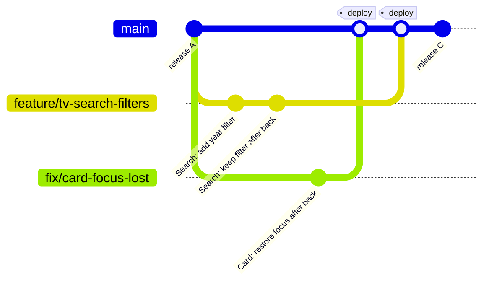
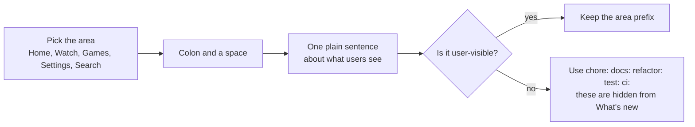
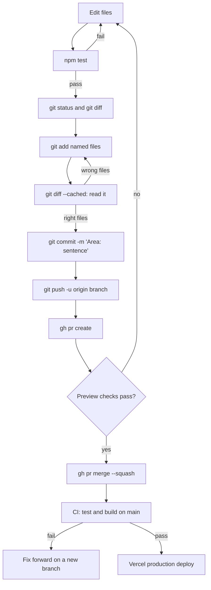
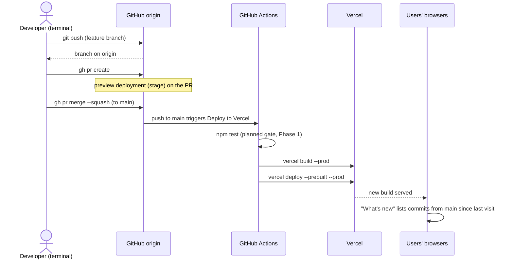

# Git workflow: branches, features, fixes, commit and push

All steps are terminal commands. Pull requests use the GitHub CLI (`gh`); you can also open them in the browser, but nothing requires it.

Read this with [DEVELOPMENT.md](DEVELOPMENT.md) (environments and checks) and [AUDIT.md](AUDIT.md) (why some rules exist).

## The three rules

1. **`main` is production.** Every commit on `main` is deployed and appears in the app's "What's new" list. Keep it green.
2. **Work on a branch.** One branch per feature or fix. Never commit directly to `main`.
3. **Commit only your own files.** Other people's uncommitted work may be in the same folder. Add files by name.

## Branch names

| Prefix | Use for | Example |
|---|---|---|
| `feature/` | New behaviour | `feature/tv-search-filters` |
| `fix/` | A bug, in normal priority | `fix/card-focus-lost-on-back` |
| `hotfix/` | A bug that is broken in production now | `hotfix/player-crash-on-open` |
| `docs/` | Documentation only | `docs/git-workflow` |
| `chore/` | Tooling and maintenance | `chore/eslint-setup` |

Rules:
- Lowercase, words separated by `-`, 3 to 5 words.
- One topic per branch. If the branch grows a second topic, start a second branch.
- Delete the branch after it merges.

## Branch model



## Everyday workflow

### 1. Start from an up-to-date `main`

```bash
git switch main
git fetch origin
git pull --ff-only origin main
```

`--ff-only` refuses to create a merge commit on `main` by accident. If it refuses, something local is wrong: stop and read `git status`.

### 2. Create the branch

```bash
git switch -c feature/tv-search-filters
```

Working on two things at once? Use a second folder instead of stashing:

```bash
git worktree add ../hooktv-fix-focus -b fix/card-focus-lost origin/main
cd ../hooktv-fix-focus && npm ci
```

Remove it when merged: `git worktree remove ../hooktv-fix-focus`.

### 3. Work and check

```bash
npm start                      # see the change in the browser
npm test                       # unit tests
git status                     # see exactly what changed
git diff                       # read every line before you commit
```

### 4. Commit

```bash
git add src/components/search.js src/sass/components/search.scss spec/search_filters.spec.js
git diff --cached             # the staged diff is what gets committed; read it
git commit -m "Search: filters keep their place after back"
```

Never use `git add .` or `git commit -a` in a shared folder. They pick up other people's changes.

### 5. Commit message

Format: `Area: plain sentence`. The text becomes the "What's new" entry, so write it for a user.



Good (from the real history on `main`):
- `Home: Streaming and Studios chips switch the services row`
- `Watch: torrent fallback when no online source plays`
- `Settings: what's changed under an Info row, with version and date`

Bad:
- `fix stuff` (no area, not a sentence)
- `WIP` (a work-in-progress commit belongs on your feature branch, squashed before merge; it must not reach `main`)
- `Updated files` (says nothing to a user)

Hidden prefixes (from [scripts/releases.js](../scripts/releases.js)): `wip`, `merge`, `chore`, `ci`, `build`, `test`, `tests`, `doc`, `docs`, `style`, `refactor`. Use them only when the change should **not** appear in the app.

Subject: under 72 characters. Body (optional): why, not what.

### 6. Push the branch

```bash
git push -u origin feature/tv-search-filters
```

`-u` sets the upstream once; later pushes are just `git push`.

### 7. Open a pull request

```bash
gh pr create --base main --fill --title "Search: filters keep their place after back"
```

Use the commit subject as the PR title. With squash merge (step 9), the **PR title** becomes the commit on `main`.

The preview URL appears on the PR once [stage](DEVELOPMENT.md#stage) is set up. Test it there before merging.

### 8. Keep the branch current

When `main` moved on:

```bash
git fetch origin
git rebase origin/main
npm test
git push --force-with-lease
```

`--force-with-lease` is allowed **only on your own feature or fix branch**. Never force-push `main`.

### 9. Merge

Only after the checks pass and the change has been reviewed.

```bash
gh pr merge --squash --delete-branch
```

Then update your local `main` and delete the local branch:

```bash
git switch main
git pull --ff-only origin main
git branch -d feature/tv-search-filters
```

## Commit and push process

This is the full path from a change on your machine to the users' screens.



## What happens after a push

Once a commit reaches `main`, this runs without anyone touching it.



Today the workflow deploys without the test step (see [AUDIT F-02](AUDIT.md#f-02-deploy-without-a-gate-p1)). Until Phase 1 lands, run `npm test` yourself before merging.

## Hotfix

When production is broken now:

```bash
git switch main && git pull --ff-only origin main
git switch -c hotfix/player-crash-on-open
# fix, then:
npm test && npm run release
git add <files> && git commit -m "Player: stop a crash when the source list is empty"
git push -u origin hotfix/player-crash-on-open
gh pr create --base main --fill --title "Player: stop a crash when the source list is empty"
gh pr merge --squash --delete-branch
```

Keep hotfixes to one topic. Do not bundle a feature into a hotfix.

## Resolving conflicts

```bash
git fetch origin
git rebase origin/main          # or: git merge origin/main on a shared branch
# conflicts are listed by:
git status
# open each file, resolve the <<<<<<< ======= >>>>>>> blocks, then:
git add <resolved-file>
git rebase --continue           # or: git commit (for a merge)
npm test
```

To stop and go back: `git rebase --abort` (or `git merge --abort`).

Before you commit a resolution, check that no marker is left:

```bash
git grep -n '^<<<<<<<' -- src api plugins spec
```

No output means no markers. This is the check that would have caught the merge currently pending on `main`'s working tree ([AUDIT F-01](AUDIT.md#f-01-unresolved-merge-in-the-working-tree-p0)).

**Shared files** (`src/components/main.js`, `src/core/component.js`, `src/core/api/sources/tmdb.js`) collide most often. Rebase your branch often, and keep each change to those files small.

## Remotes

```bash
git remote -v
```

| Remote | What it is | Use it? |
|---|---|---|
| `origin` | `andriihukco/hooktv` on GitHub | **Yes**: push and pull here |
| `hooktv` | Same repo name, a second remote | Avoid; see [AUDIT F-17](AUDIT.md#f-17-three-remotes-p3) |
| `lampro` | `andriihukco/lampro` | Not for this project |

Always write `git push origin ...` explicitly. Plain `git push` pushes to the tracking remote, which can be wrong after a branch was created from another remote.

## Quick reference

| Task | Command |
|---|---|
| New branch | `git switch -c feature/<name>` |
| See changes | `git status` then `git diff` |
| Stage named files | `git add <file> <file>` |
| Read what will be committed | `git diff --cached` |
| Commit | `git commit -m "Area: sentence"` |
| Push first time | `git push -u origin <branch>` |
| Open PR | `gh pr create --base main --fill` |
| Update branch on `main` | `git fetch origin && git rebase origin/main` |
| Merge PR | `gh pr merge --squash --delete-branch` |
| Undo last commit, keep changes | `git reset --soft HEAD~1` (only before pushing) |
| List branches | `git branch -vv` |
| Clean merged local branches | `git branch --merged main` (review, then `git branch -d <name>`) |
