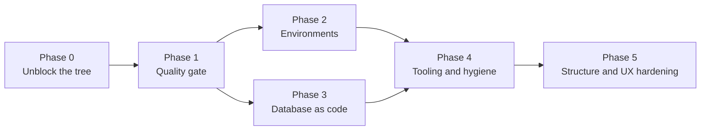

# HOOK TV: implementation plan

Derived from the [engineering audit](AUDIT.md) of 2026-10-30. Finding IDs (F-xx) refer to that report.

Each phase lists its tasks, the files involved, an effort estimate (S = under 2 h, M = half a day, L = 1 to 3 days), dependencies, and a **definition of done**. A task is done only when its definition of done is met and the checks pass (see [DEVELOPMENT.md](DEVELOPMENT.md#checks-before-you-push)).

## Phase 0: unblock the tree

**Goal:** the working tree builds and no merge is pending.

| # | Task | Files | Effort | Owner |
|---|---|---|---|---|
| 0.1 | Decide who resolves the merge of `feature/game-localisation` into `main`. | `.git/MERGE_HEAD` | S | Product owner |
| 0.2 | Resolve the 8 conflicted files. Keep the newer behaviour from each side only where the feature needs it. | `src/components/main.js`, `src/core/component.js`, `src/core/api/sources/tmdb.js`, `src/interaction/card/module/style.js`, `src/interaction/screensaver/ukraine.js`, `src/sass/components/card.scss`, `src/sass/components/screensaver.scss`, `src/interaction/screensaver/weather.js` (deleted on one side) | M | Feature owner |
| 0.3 | `node --check` every changed JS file; `npm test`; `npm run release`. | all | S | Feature owner |
| 0.4 | Commit the merge. Do not include unrelated work. | git | S | Feature owner |

**Dependencies.** None. Everything else waits for 0.4 because the other branches would otherwise build on a broken tree.

**Definition of done.** `git status` shows no `UU`/`DU`; `grep -rn '^<<<<<<<' src` is empty; `npm test` and `npm run release` pass.

## Phase 1: add the quality gate

**Goal:** nothing reaches `main` or production without passing tests and a build.

| # | Task | Files | Effort |
|---|---|---|---|
| 1.1 | Commit `package-lock.json`; remove it from `.gitignore`. | `.gitignore`, `package-lock.json` | S |
| 1.2 | Add `.nvmrc` with `22`, and `"engines": {"node": ">=22"}` in `package.json`. | `.nvmrc`, `package.json` | S |
| 1.3 | Add `.github/workflows/ci.yml`: on pull requests and pushes to `main`, run `npm ci`, `npm test`, `npm run release`. | `.github/workflows/ci.yml` | S |
| 1.4 | Make the Vercel deploy job depend on CI (`needs: ci` via a reusable workflow, or a `test` job in the same file). | `.github/workflows/vercel-deploy.yml` | S |
| 1.5 | Enable branch protection on `main`: require the CI check, block force pushes. (GitHub settings, done by the repository admin.) | GitHub settings | S |
| 1.6 | Replace `npm install` with `npm ci` in the deploy workflow and in `vercel.json` (`installCommand`). | `.github/workflows/vercel-deploy.yml`, `vercel.json` | S |
| 1.7 | Add security headers to `vercel.json`: `X-Content-Type-Options: nosniff`, `Referrer-Policy: strict-origin-when-cross-origin`, `X-Frame-Options: DENY`. Add a CSP in report-only mode after a route-by-route console check. | `vercel.json` | M |
| 1.8 | Add the test for each new header (extend `spec/`). | `spec/` | S |

**Dependencies.** 1.1 before 1.6. Phase 0 done.

**Definition of done.** A pull request that breaks `npm test` shows a failing check and cannot merge. A push to `main` that breaks the build does not deploy. `npm ci` on a clean clone reproduces the same `build/web` hashes as the lockfile.

**Risk.** A CSP that is too strict breaks TMDB images or the player. Start in report-only mode (`Content-Security-Policy-Report-Only`).

## Phase 2: environments

**Goal:** dev, stage and production are separate, and staging is where branches are checked.

| # | Task | Files | Effort |
|---|---|---|---|
| 2.1 | Create a staging Supabase project and apply the migrations to it (`supabase link`, `supabase db push`). | Supabase | M |
| 2.2 | Link the Vercel project and set Preview-scope variables (`SUPABASE_URL`, `SUPABASE_ANON_KEY`, `SUPABASE_SIGNIN_URL`, `TMDB_API_KEY`) to the staging values. Production keeps its own. | Vercel | S |
| 2.3 | Confirm that every non-`main` push gets a preview URL. If the GitHub integration is off, use `vercel deploy` (without `--prod`) in a CI job. | `.github/workflows/` | M |
| 2.4 | Document the flow in [DEVELOPMENT.md](DEVELOPMENT.md#stage). | `docs/DEVELOPMENT.md` | S |
| 2.5 | Decide the remote layout (F-17): keep `origin` and remove the others, or document them. | git remotes | S |

**Dependencies.** Phase 1 (preview deploys should run the same gate).

**Definition of done.** Pushing `feature/x` produces a preview URL that uses the staging database. Production variables are never used on a preview.

## Phase 3: database as code

**Goal:** the schema is defined only by migrations, and the RLS rules are tested on every change.

| # | Task | Files | Effort |
|---|---|---|---|
| 3.1 | Confirm nobody uses `supabase-setup.sql`, then delete it. (F-06) | `supabase-setup.sql` | S |
| 3.2 | Add a CI job: `supabase start` (Docker), `supabase db reset`, then `psql -f supabase/tests/rls.sql`. Fail on any error. (F-05) | `.github/workflows/ci.yml`, `supabase/tests/rls.sql` | M |
| 3.3 | Make each new table or policy come with an RLS case in `rls.sql`. Write this in the migration review checklist. | `docs/DEVELOPMENT.md` | S |
| 3.4 | Confirm the RPCs `set_reaction` and `reaction_counts` are `security definer` only where needed, and set `search_path`. | `supabase/migrations/0004_reactions.sql` | S |

**Dependencies.** Phase 1 (CI exists).

**Definition of done.** `rls.sql` runs green in CI on a clean database. A deliberately broken policy makes the job fail (verify once, then revert).

## Phase 4: tooling and hygiene

**Goal:** quality rules run automatically, and no generated or local files are tracked.

| # | Task | Files | Effort |
|---|---|---|---|
| 4.1 | Add ESLint (flat config): `no-undef`, `no-unused-vars` for `src/`, `api/`, `middleware.js`. Start with warnings for existing files and errors for new files. (F-09) | `eslint.config.js`, `package.json` | M |
| 4.2 | Add `.editorconfig` (indent, final newline, LF). The repo already sets `text=auto`. | `.editorconfig` | S |
| 4.3 | Replace `console.log` in `src/` and `api/` with a small logger that is silent in release builds. (F-12) | `src/utils/log.js` (new), call sites | M |
| 4.4 | Stop committing `build/github/` output, or document it as an artifact (F-07). Decide with the release owner first. | `build/github/`, `gulpfile.js` | M |
| 4.5 | Untrack `.freebuff/`, ignore `.freebuff/`, `.claude/worktrees/`, `.superpowers/` in `.gitignore`. (F-14, F-18) | `.gitignore` | S |
| 4.6 | Remove `FIXES.md` and `REFACTORING_SUMMARY.md`; fix the StreamFlow sentence in README. (F-15) | root docs | S |
| 4.7 | Settle the worktree: push or commit `feature/music-redesign`, then `git worktree remove`. (F-08) | git | S |
| 4.8 | Upgrade vitest from 0.32 to the current major, one major at a time, in its own change. (F-13) | `package.json` | M |

**Dependencies.** Phase 1.

**Definition of done.** `npm run lint` passes with zero errors. `git ls-files` contains no tool-local directories. No `console.log` in `src/` outside the logger.

## Phase 5: structure and UX hardening

**Goal:** the largest files stop being a merge risk, and the core flows are verified in a browser.

| # | Task | Files | Effort |
|---|---|---|---|
| 5.1 | Split `src/services/online.js` one provider per file, only when a provider changes next. (F-11) | `src/services/` | L |
| 5.2 | Centralise the TMDB key and the base URL. (F-16) | `src/core/tmdb/tmdb.js`, `api/*.js` | S |
| 5.3 | Add Playwright smoke tests for `/`, `/design`, one `/movie/:id`, and the settings screen. | `spec/e2e/` (new) | M |
| 5.4 | Add an axe scan on the same pages; fail on serious and critical issues. | `spec/e2e/` | S |
| 5.5 | Manual check: TV remote focus order, 44 px touch targets, dark-theme secondary contrast. Record results in `docs/`. | `docs/` | M |
| 5.6 | Rename `src/core/tmdb/keys.js` to a name that says it filters content. (F-19) | `src/core/tmdb/` | S |

**Dependencies.** Phase 4.

**Definition of done.** Smoke and axe checks run in CI. The manual checks are recorded with the date, device and result.

## Effort summary

| Phase | Effort | Blocks |
|---|---|---|
| 0 | S to M | Everything |
| 1 | M | Phases 2, 3, 4 |
| 2 | M | Safe releases |
| 3 | M | Database changes |
| 4 | M to L | Hygiene |
| 5 | L | Long-term quality |

## Risks

- **Phase 0 takes longer than expected** because the conflicts touch shared files. Mitigation: finish that merge before starting anything else on those files.
- **CSP breaks playback or images.** Mitigation: report-only first.
- **Staging database drifts from production.** Mitigation: migrations only (Phase 3), and `supabase db push` in the release checklist.
- **Lockfile upgrade changes the bundle.** Mitigation: commit the lockfile in its own change (1.1), then check the build.
